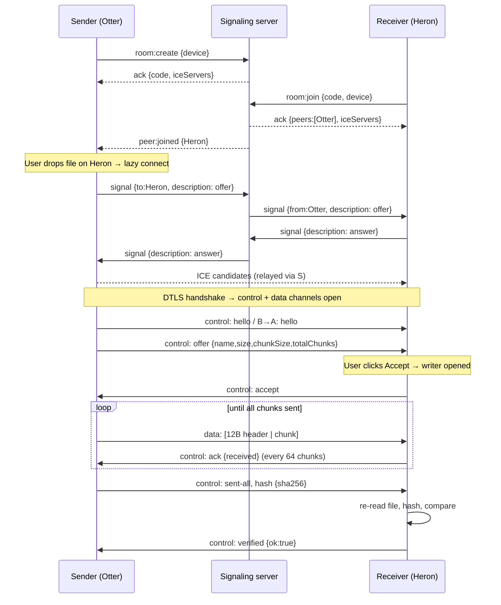

# DropZone — Final Working & Build Plan

**Purpose:** describes exactly how the finished product behaves end to end, then gives an ordered, verifiable build plan for a coding agent (Antigravity / OpenCode). Read with `PRD.md`, `TRD.md`, `AGENTS.md`.

---

## 1. The finished product, as a user sees it

1. **Aisha** opens `dropzone.app` on her laptop and clicks **Create room**. She gets code `K7M2QX`, a QR code, and a 10-minute countdown. Her device is named "Swift Otter".
2. She scans the QR with her phone. The phone opens `/r/K7M2QX`, auto-names itself "Calm Heron", and appears in her peer grid within a second.
3. Aisha drags `lecture.mp4` (2.3 GB) onto the Heron card. A connection badge turns **Connecting → Direct (local network)**.
4. The phone shows an **incoming dialog**: "Swift Otter wants to send lecture.mp4 (2.3 GB)". She taps **Accept**.
5. Both screens show a progress bar, speed (e.g. 38 MB/s), and ETA. Aisha opens Diagnostics: RTT 6 ms, candidate pair host↔host, UDP.
6. Mid-transfer she walks out of Wi-Fi range for 10 seconds. The status shows **Reconnecting…**, then the transfer **resumes** from where it stopped, with no restart.
7. On completion both screens show **Verified ✓ (SHA-256)**. The file is saved to disk (Chromium: directly to the location chosen on Accept; others: a download prompt).
8. Optional: both devices show the same SAS `482 917`, confirming no tampering.

## 2. Under the hood: step by step

**Key mechanics**
- **Discovery:** peer list = server-side room membership (presence). WebRTC connects lazily.
- **Connection:** perfect negotiation, negotiated DataChannels (id 0 control, id 1+ data), ICE with STUN, TURN fallback.
- **Flow control:** two nested limits: `bufferedAmount` (network) and ack window of 16 MiB (receiver disk).
- **Storage:** Chromium writes positionally to the chosen file; others stage in OPFS, then hand a disk-backed `File` to the browser's download.
- **Resume:** receiver's chunk bitmap (persisted in IndexedDB) tells the sender exactly which chunks to resend.
- **Integrity:** sender hashes in a worker while sending; receiver re-hashes the stored file at the end.
- **Diagnostics:** `getStats()` each second → connection class + RTT + bitrate.

## 3. Failure and edge-case behavior

| Situation | Expected behavior |
|-----------|-------------------|
| Wrong/expired code | "Code not found or expired. Ask for a new one." No retry hammering (rate limited) |
| Room full | `ROOM_FULL` message |
| Receiver declines | Sender row shows "Declined"; no data sent |
| Receiver has no space | Pre-accept warning; if accepted anyway and write fails → cancel both sides with message |
| Sender closes tab mid-transfer | Receiver shows "Sender disconnected", keeps partial data + bitmap for resume (24 h) |
| Receiver closes tab | Sender shows "Receiver disconnected", waits for reconnect up to 5 min then marks interrupted |
| Signaling server drops | Client reconnects with backoff; existing WebRTC transfers continue; rejoin room via stored code if still alive |
| Direct fails, TURN available | Badge "Relayed"; warn that speed depends on relay |
| Hash mismatch | "Verification failed." Offer Retry; delete partial file |
| Duplicate file name on receiver | Auto-suffix `name (1).ext` |
| Two users offer simultaneously | Independent `transferId`s; per-peer concurrency cap 3, others queue |
| iOS/background tab suspended | Wake Lock requested; on foreground, auto-resume |
| Browser lacks required API | Capability check on load; show tailored message and fallback backend |
| Clock skew | Never trust client clocks for expiry; the server is authoritative |

## 4. Build plan for the coding agent

Each phase ends with a **gate**. Do not start the next phase until the gate passes. Commit after every phase (`feat(phase-N): …`).

### Phase 0 — Foundation
- Create pnpm monorepo per `TRD §3`, TS strict base config, ESLint, Prettier, Vitest, husky + lint-staged, `.editorconfig`, `.gitignore`, `.env.example` files.
- Scaffold `apps/web` (Vite + React + TS + Tailwind + Router), `apps/signaling` (Express + Socket.IO), `packages/protocol`.
- Root scripts: `dev`, `build`, `lint`, `typecheck`, `test`, `e2e`.
- **Gate:** `pnpm dev` starts both apps; `pnpm lint && pnpm typecheck && pnpm test` pass.

### Phase 1 — Protocol package
- Implement zod schemas, error codes, constants, `frame.ts` (encode/decode) with full unit tests (round trip, malformed input).
- **Gate:** protocol tests pass; types imported by both apps.

### Phase 2 — Signaling server (FR-01–08)
- `RoomStore` (interface + in-memory), code generator, TTL/idle/hard-expiry timers, handlers for all events, limits, ICE credential issuance, `/healthz`, `/metrics`, pino logging.
- Integration tests with `socket.io-client` covering every error code and rate limits.
- **Gate:** integration tests pass; coverage ≥ 80%.

### Phase 3 — Web shell, rooms, presence (FR-02–06, 40, 41)
- Landing, Room route, `SignalingClient` with reconnect/backoff, stores, `PeerGrid`, device naming, theme, responsive layout, QR card, countdown.
- **Gate:** two browser tabs create/join a room and see each other live; rename propagates.

### Phase 4 — WebRTC connection (FR-05, 30)
- `PeerSession` with perfect negotiation, negotiated channels, `hello` exchange, ping/pong, connection-state UI, `stats.ts` classifier (badge).
- **Gate:** two tabs connect; badge shows Direct (local); text round trip over control channel works. Add debug flag to force relay for later tests.

### Phase 5 — Basic transfer (FR-10–12, 15, 16)
- Offer/accept/reject UI, `TransferSender`/`TransferReceiver` with fixed chunking, `MemoryWriter`, progress/speed/ETA, cancel.
- **Gate:** 10 MB file transfers correctly, bytes identical (manual diff / e2e).

### Phase 6 — Large files and reliability (FR-13, 14, 17, 18, 20, 44, 45)
- `FsAccessWriter` + `OpfsWriter` (+ worker), capability detection, backpressure (bufferedAmount + ack window), prefetch queue, bitmap + `resumeStore`, reconnect + ICE restart, `resume` protocol, hash worker + verification, filename sanitizer, storage estimate.
- **Gate (Playwright):** 1 GB transfer with tab memory < 300 MB; drop connection at 50% → resumes and verifies; 100 MB in Firefox and WebKit.

### Phase 7 — Insight and trust (FR-31–33, 21)
- Diagnostics drawer, SAS, benchmark page + CSV, multi-peer concurrency, optional multi-channel; run benchmark and set default channel count/chunk size from results; write `docs/benchmarking.md`.
- **Gate:** benchmark runs; SAS matches on both ends; 2 simultaneous transfers to 2 peers succeed.

### Phase 8 — Hardening and polish (FR-07, 08, 19, 42, accessibility)
- Host approval, code regenerate, reload-resume, PWA, a11y pass (axe), error boundaries, empty/error states, CSP + security headers, rate-limit tuning, fuzz the frame parser.
- **Gate:** axe has no serious violations; Lighthouse ≥ 90; reload-resume e2e passes.

### Phase 9 — Production
- Dockerfile + `infra/docker-compose.yml` (signaling + coturn), Vercel config, GitHub Actions CI/CD, environment docs, TURN deployment with TLS on 443, domain/DNS, smoke test script, README with architecture diagram and honest limitations.
- Test on real devices and networks: laptop↔phone same Wi-Fi, laptop on Wi-Fi ↔ phone on mobile data (must use STUN/TURN), restrictive network (force relay).
- **Gate:** production checklist below fully ticked.

## 5. Definition of done / production checklist

- [ ] All P0 and P1 FRs implemented; each has a passing test or documented manual check
- [ ] 5 GB transfer succeeded on Chromium desktop; memory stayed < 300 MB
- [ ] Resume works after forced disconnect and after reload
- [ ] Verified badge appears; tampered chunk test shows failure
- [ ] Cross-browser e2e green (Chromium, Firefox, WebKit); manual Android + iOS check logged
- [ ] Works across different networks (mobile data ↔ Wi-Fi); relay case verified
- [ ] Zero file names/contents in server logs (log review)
- [ ] CSP, security headers, rate limits verified; `pnpm audit` clean of high/critical
- [ ] Lighthouse ≥ 90; first-load JS ≤ 180 KB gz
- [ ] Monitoring and alerts live; `/healthz` wired to host
- [ ] README: setup, architecture, protocol summary, benchmark results, known limits
- [ ] CI green on `main`; auto deploy works; rollback documented

## 6. Demo script and talking points

**3-minute demo:** create room → QR join from phone → send 1 GB video → show Diagnostics (direct vs relayed) → kill Wi-Fi briefly → auto-resume → Verified ✓ → show benchmark table.

**Points worth being ready to explain:**
- Why signaling is separate from data, and why Vercel can't host Socket.IO
- STUN vs TURN; how the badge is derived from the selected candidate pair
- Backpressure: `bufferedAmount` plus an application-level ack window
- Why unordered-reliable channels + chunk indexes enable resume and parallel channels
- Storage strategy per browser and why Blobs in RAM don't scale
- What SAS protects against that DTLS alone does not (a malicious signaling server)

## 7. Prompts to give the agent

**Master prompt (first message):**
> Read `AGENTS.md`, `docs/PRD.md`, `docs/TRD.md`, and `docs/WORKING.md` fully. You are building DropZone from scratch to production in this repo. Work strictly phase by phase per `WORKING.md §4`. After each phase: run lint, typecheck, tests, confirm the gate, commit, then summarize what passed and what's next before continuing. If a requirement is ambiguous or a browser API behaves differently than specified, choose the safest option, record it in `docs/DECISIONS.md`, and continue. Start with Phase 0.

**Per-phase prompt:**
> Execute Phase N from `docs/WORKING.md §4`. Re-read the referenced TRD sections first. Implement, write the tests the gate requires, run them, fix failures, then commit and report gate status.

**Bug/iteration prompt:**
> Reproduce `<issue>` with a failing test first, fix it, confirm all existing tests still pass, and note any protocol change in `packages/protocol` and `TRD.md`.
